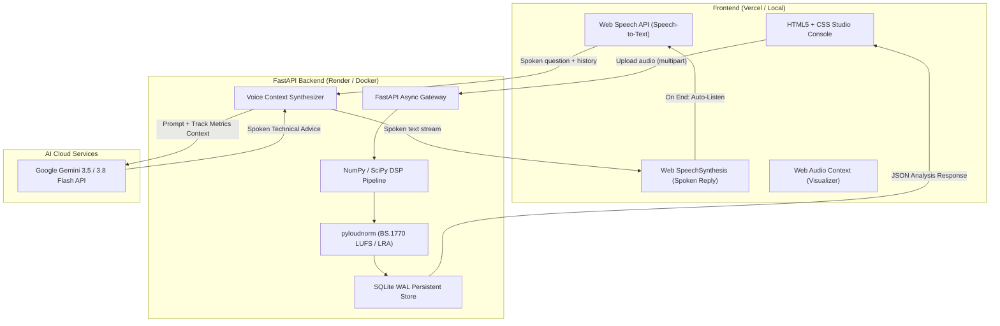

<div align="center">

# 🎛️ Mixora ✦ AI Mixing Assistant

**Real-Time DSP Audio Analysis & Conversational Voice AI Studio Assistant**

Turn rough mixes into streaming-ready masters with studio-grade acoustic metrics, commercial reference matching, and a real-time Voice AI that listens, analyzes, and talks back.

[](LICENSE)
[](https://python.org)
[](https://fastapi.tiangolo.com)
[](https://developer.mozilla.org/en-US/docs/Web/API/Web_Audio_API)
[](https://ai.google.dev)
[](CONTRIBUTING.md)

[🌐 Live Web App](https://mixora-red.vercel.app) • [📡 API Health](https://mixora-kprj.onrender.com/health) • [📖 Documentation](#-quickstart-guide) • [🚀 Self-Hosting](#-self-hosting--docker) • [💬 Report Bug](https://github.com/adithya-prakash/mixora/issues)

</div>

---

## ⚡ What is Mixora?

**Mixora** acts like an expert mixing and mastering engineer sitting right beside you in your studio. Instead of making you decipher complicated technical charts in isolation, Mixora combines **precision DSP measurement** with a **conversational Voice AI**.

Drop any WAV or MP3 track into the browser: Mixora evaluates integrated LUFS, true peak, dynamic range (LRA), phase correlation, and 5-band frequency energy in under a second. Then, tap the microphone to talk back and forth with the AI engineer to diagnose masking issues, balance low-end rumble, or dial in the right loudness for Spotify, Apple Music, and club sound systems.

---

## ✨ Key Features

### 🎙️ Conversational Voice AI (Hands-Free Loop)
* **Real-time Voice Chat:** Speak naturally with your microphone. Mixora listens, processes your track's live metrics, and speaks back with targeted DAW instructions.
* **Continuous Back-and-Forth:** When Mixora finishes speaking, the microphone auto-resumes listening so you can continue the dialogue hands-free while producing.
* **Context-Aware Dialogue:** Remembers previous turns (e.g. *"What's wrong with the low end?"* followed by *"How do I fix that bass frequency you mentioned?"*).
* **Powered by Gemini Flash:** Ultra-fast sub-second responses via Google Gemini 3.5 Flash-Lite & 3.8 Flash with a zero-thinking-latency pipeline.

### 📊 Studio-Grade DSP Acoustic Engine
* **Loudness Standards:** Vectorized ITU-R BS.1770-4 gated integrated loudness (**LUFS**) and EBU Tech 3342 Loudness Range (**LRA**).
* **Dynamic Punch & Crest Factor:** Peak-to-RMS crest ratio calculation to verify punch without ear fatigue.
* **Sample-Accurate Clipping Detector:** Identifies consecutive zero-crossing runs to prevent digital inter-sample distortion.
* **Linear-Phase Resampling:** Vectorized 44.1 kHz resampling running in pure C/NumPy with zero latency.

### 🎚️ 5-Band Spectral Energy & Parametric EQ Curve
* **Frequency Band Breakdown:** Displays energy percentage across **Sub-bass** (20–60 Hz), **Bass** (60–250 Hz), **Midrange** (250–2k Hz), **High-mid** (2k–6k Hz), and **Highs** (6k–20k Hz).
* **Parametric Curve Visualizer:** 8-band interactive EQ overlay to spot tonal imbalances, harsh sibilance, and muddy buildups.

### ↔️ Stereo Coherence & Phase Alignment
* **Phase Correlation Meter:** Real-time correlation index from `-1.0` (antiphase) to `+1.0` (mono).
* **Mono Compatibility Screening:** Alerts you if wide stereo elements will cancel out on smartphones, Bluetooth speakers, or club PAs.
* **Stereo Width & Balance:** Exact left/right decibel balance and spatial width measurement.

### 🔄 A/B Reference Comparison & Revision Tracking
* **Commercial Reference Matching:** Upload a reference track alongside your mix to contrast LUFS, EQ contours, and stereo spread side-by-side.
* **Revision Delta Tracking:** Upload Mix V2 to get an instant Delta ($\Delta$) comparison showing whether your changes solved clipping or improved tonal balance.

---

## 🏗️ Architecture



---

## 🚀 Quickstart Guide

Get Mixora running locally on your computer in under 2 minutes.

### Prerequisites
* **Python 3.11+** installed
* **FFmpeg** installed on your system (optional for WAV, required for MP3 decoding)
* A modern browser (Chrome, Edge, Safari, Firefox)

### 1. Clone the Repo
```bash
git clone https://github.com/adithya-prakash/mixora.git
cd mixora
```

### 2. Setup Python Environment

**On Linux / macOS:**
```bash
python3 -m venv .venv
source .venv/bin/activate
pip install -r backend/requirements.txt
```

**On Windows (PowerShell):**
```powershell
python -m venv .venv
.venv\Scripts\Activate.ps1
pip install -r backend\requirements.txt
```

### 3. Configure API Key (Optional for Voice AI)
Create a `.env` file in the root directory:
```bash
cp backend/.env.example .env
```
Add your free Google Gemini API Key from [Google AI Studio](https://aistudio.google.com/apikey):
```env
GEMINI_API_KEY=your_gemini_api_key_here
```
*(Note: If no API key is provided, Mixora's audio DSP analysis works 100% locally with intelligent offline engineering heuristics!)*

### 4. Launch the Backend
```bash
uvicorn backend.app.main:app --reload --port 8000
```
API interactive documentation will be live at `http://127.0.0.1:8000/docs`.

### 5. Open the Frontend
Simply open `index.html` in your browser, or serve it with Python:
```bash
python -m http.server 3000
```
Open [http://localhost:3000](http://localhost:3000) and start analyzing!

---

## 🐳 Self-Hosting with Docker

You can run the entire backend with persistent storage in one command:

```bash
# Clone and enter directory
git clone https://github.com/adithya-prakash/mixora.git
cd mixora

# Launch via Docker Compose
docker compose up -d
```
Mixora will be available at `http://localhost:8000`.

---

## 🌐 Deploy to Production (Free Tier)

Mixora is architected to deploy easily on popular free hosting tiers:

### Backend: Render.com
1. Fork this repository to your GitHub account.
2. In [Render Dashboard](https://dashboard.render.com), create a **New Web Service** connected to your repo.
3. Configure the service:
   - **Runtime:** `Python 3`
   - **Build Command:** `pip install -r backend/requirements.txt`
   - **Start Command:** `uvicorn backend.app.main:app --host 0.0.0.0 --port $PORT`
4. In **Environment Variables**, add:
   - `GEMINI_API_KEY` = your Google AI Studio key
   - `ALLOWED_ORIGINS` = `*` (or your frontend domain)

### Frontend: Vercel / GitHub Pages
1. Deploy `index.html` directly to [Vercel](https://vercel.com) or GitHub Pages.
2. Ensure line 5 of `index.html` points to your Render backend URL:
   ```html
   <script>window.API_BASE = "https://your-backend.onrender.com";</script>
   ```

---

## 📡 API Reference

Interactive Swagger UI documentation is available at `/docs`.

| Endpoint | Method | Description |
| :--- | :--- | :--- |
| `/health` | `GET` | Service liveness probe. |
| `/analyze` | `POST` | Upload mix (`file`), optional `reference`, and `genre` (`multipart/form-data`). |
| `/analysis/{id}` | `GET` | Retrieve cached analysis results by ID (immutable, edge-cacheable). |
| `/compare` | `POST` | Compare a revision mix against a previous analysis ID. |
| `/voice/ask` | `POST` | Ask a question about an analysis with multi-turn history. |

### Example: Running an Audio Analysis via cURL
```bash
curl -X POST "http://localhost:8000/analyze" \
  -F "file=@your_mix.wav" \
  -F "genre=Dubstep"
```

### Example: Asking Voice AI via cURL
```bash
curl -X POST "http://localhost:8000/voice/ask" \
  -H "Content-Type: application/json" \
  -d '{
    "analysis_id": "an_beebcbbd210b44428fb35c04a1e23b4c",
    "question": "Why is my sub-bass dominating the mix?",
    "history": []
  }'
```

---

## 🧪 Testing

Mixora comes with comprehensive test suites for acoustic math, audio decoding, and API schema compliance:

```bash
# Run all tests
python -m unittest discover -s backend/tests -v
```

* `backend/tests/test_dsp.py`: Verifies dB levels, sine tone precision, clipping detection, and antiphase stereo warning.
* `backend/tests/test_audio.py`: Tests float audio conversion, 44.1 kHz resampling, duration thresholds, and corrupt file handling.
* `backend/tests/test_api.py`: Validates FastAPI routing, CORS, and strict schema compliance.

---

## 🤝 Contributing

We welcome open-source contributions from audio developers, producers, and AI engineers! 
Please review our [Contributing Guidelines](CONTRIBUTING.md) to get started.

1. Fork the Project
2. Create your Feature Branch (`git checkout -b feature/AmazingFeature`)
3. Commit your Changes (`git commit -m 'feat: add amazing feature'`)
4. Push to the Branch (`git push origin feature/AmazingFeature`)
5. Open a Pull Request

---

## 📄 License

Distributed under the **MIT License**. See [`LICENSE`](LICENSE) for more information.

---

<div align="center">
  <sub>Built with ❤️ for music producers, mix engineers, and audio hackers worldwide.</sub>
</div>
